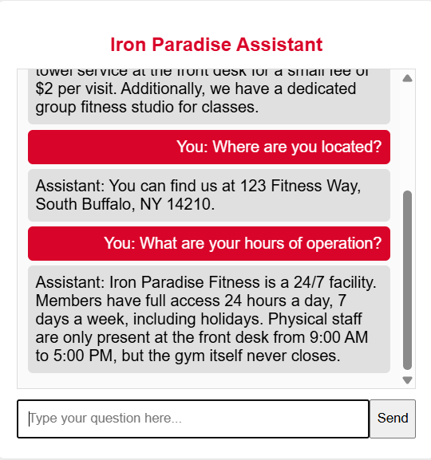
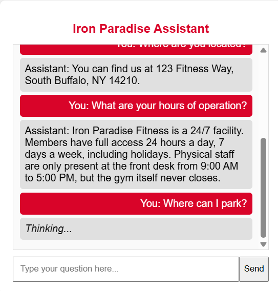
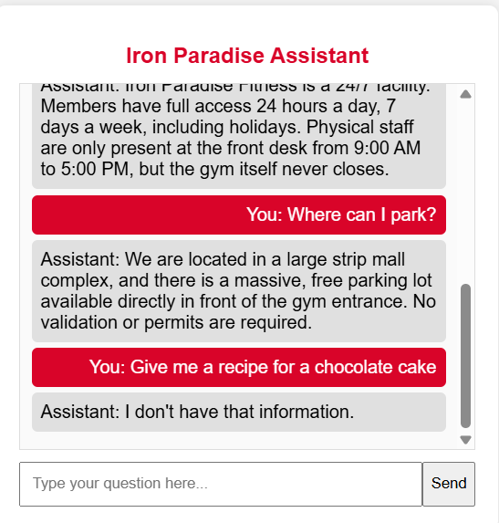
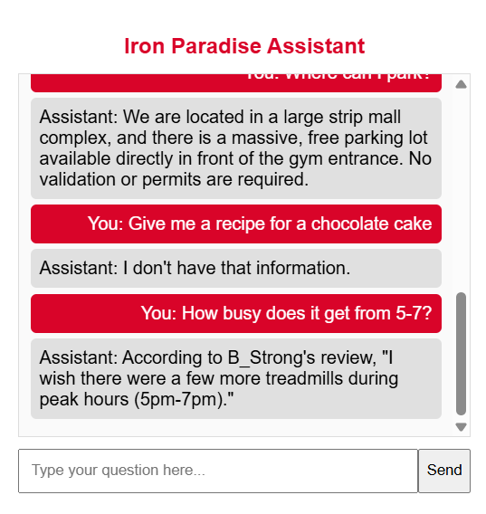

# Iron Paradise Customer Service Assistant

A gym customer service chatbot built by Nate Eaton with FastAPI, LangChain, Ollama, and a plain HTML/CSS/JavaScript frontend. It answers questions about Iron Paradise Fitness using supplied gym information and customer reviews.

## Demo

These screenshots were extracted from the project report, *Project AI App Development (1).pdf*. They document the original demo; they are not a live hosted application.

### Location and opening hours

The assistant answers location questions and distinguishes 24/7 member access from staffed front desk hours.



### Loading feedback

A Thinking indicator appears while the backend generates a response.



### Parking and questions outside the supplied information

The assistant describes free parking and responds to an unrelated recipe request with "I don't have that information."



### Answers supported by customer reviews

For a question about busy hours, the assistant attributes its answer to B_Strong's review.



## How it works

1. The browser sends a question to the FastAPI POST /chat endpoint.
2. The backend loads gym facts from info.txt and reviews from reviews.csv.
3. All supplied facts and reviews are included in a prompt sent to the local llama3 model through ChatOllama, with temperature set to 0.
4. The response appears in the chat interface.

The prompt instructs the model to use only the supplied information, cite reviewers when using reviews, and acknowledge missing information. The current implementation supplies the full context on each request; it does not use a vector database or a separate retrieval index.

## Run locally

Prerequisites: Python 3.10 or later, [Ollama](https://ollama.com/), and enough local resources to run the llama3 model. The model download requires internet access.

Clone this repository and open its directory:

```sh
git clone https://github.com/neaton21/CustomerServiceProject.git
cd CustomerServiceProject
```

Create and activate a virtual environment (Windows PowerShell):

```powershell
python -m venv .venv
.\.venv\Scripts\Activate.ps1
```

On macOS/Linux, activate it with `source .venv/bin/activate` instead.

Install the backend dependencies:

```sh
python -m pip install fastapi uvicorn pydantic langchain-ollama
```

Download the model and keep Ollama running:

```sh
ollama pull llama3
ollama serve
```

If the Ollama desktop app is already running its local server, a second `ollama serve` process is unnecessary.

Start the backend from its own directory so the relative data-file paths resolve correctly:

```sh
cd CustomerServiceProject/backend
python -m uvicorn main:app --reload --host 127.0.0.1 --port 8000
```

In a second terminal, starting from the repository root, serve the frontend:

```sh
cd CustomerServiceProject/frontend
python -m http.server 5500 --bind 127.0.0.1
```

Open [the frontend](http://127.0.0.1:5500). The backend status is available at [port 8000](http://127.0.0.1:8000/), and interactive API documentation is at [/docs](http://127.0.0.1:8000/docs).

## Try these questions

- Where are you located?
- What are your hours of operation?
- Where can I park?
- How busy does it get from 5-7?
- Give me a recipe for a chocolate cake.

## Project structure

```text
CustomerServiceProject/
  backend/
    main.py       # FastAPI endpoints and model prompt
    info.txt      # Gym facts
    reviews.csv   # Customer reviews
  frontend/
    index.html    # Chat page
    style.css     # Styling
    app.js        # Browser interaction and API requests
docs/images/      # Demo screenshots extracted from the report
```

## Limitations

- This is a local demonstration. GitHub stores the source and screenshots; running the chatbot requires both the backend and Ollama.
- The frontend targets http://127.0.0.1:8000. Deployment elsewhere requires updating that address and configuring the backend appropriately.
- Prompt instructions guide the model but do not guarantee factual accuracy. The screenshots illustrate particular responses, and later responses may differ.
- Each request is handled independently; earlier chat messages are displayed in the browser but are not sent as conversation history to the model.
- Dependencies are currently unpinned. This README documents setup from the source; the application has not been rerun as part of adding these demo images.

